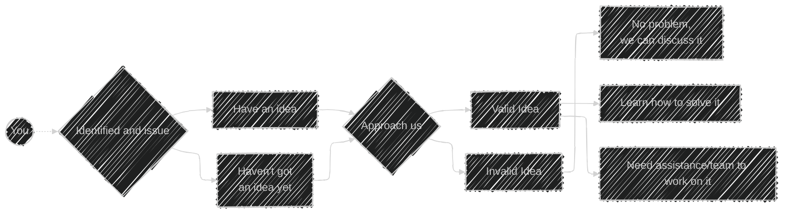

<h2>Mulearn</h2>

Mulearn exists to return something that was taken away early: agency. You are not here to fit into predefined roles. You are here to explore, to build, to fail safely, to find your edge, and to contribute before you are "ready". Your curiosity is not a distraction. It is your signal.

<h2>Mulearn SCTCE</h1>

**Mulearn SCTCE** is a student-driven community at Sree Chitra Thirunal College of Engineering under the μLearn Foundation, focusing on peer learning, skill development, and collaboration. It encourages students to explore new technologies, work on projects, and learn beyond the classroom. The community organizes workshops, boot camps, hackathons, and other technical activities to help students gain practical experience. It provides a platform for students to share knowledge, collaborate with peers, and develop their technical and professional skills. μLearn SCTCE also encourages students to contribute to open-source projects and build meaningful connections with like-minded individuals. Through its various initiatives, the community promotes a culture of continuous learning, creativity, and innovation. Its ultimate goal is to empower students to become skilled, confident, and industry-ready individuals.

### Our Initiative

Mulearn SCTCE presents Open source software development initiative based on issues **you** raise and identify. We recognize and analyse issues within the campus and outside of campus from your concerns and devise appropriate solutions for it and help you build the solution that fix the problem. We provide you with the necessary materials and help required, for you to be able to build the solution by yourself.

<i>Plan . Build . Repeat</i> Our Projects are developed and maintained by humans

### The Process
The idea submission and discussion pipeline is as follows, it has been designed and implemented as such to enable proper importance and distribution of effort and recognition for issues at all level.

